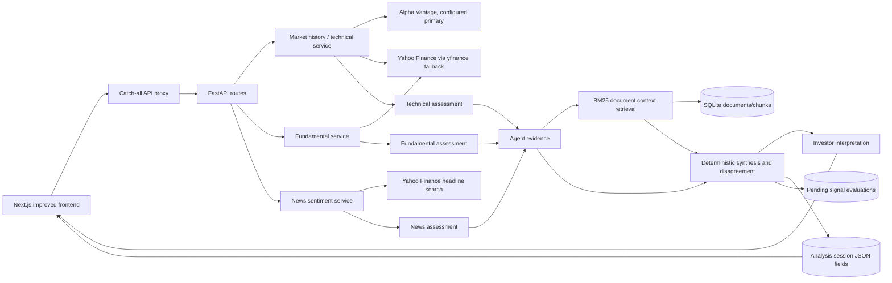

# FinWiseAI Architecture and Current Prototype Boundaries

FinWiseAI is a financial-research prototype for the PS04 VibeFinance problem. Its analysis is deterministic and rule-based. It does not call an LLM, provide investment advice, or establish predictive performance.

## 1. Current topology

The root `frontend` directory is an older separate UI; the maintained primary UI is `frontend-improved`.

## 2. Market and fundamental sources

- Historical prices try Alpha Vantage when configured, then Yahoo Finance through `yfinance`.
- Fundamentals and headlines use Yahoo Finance through `yfinance`.
- Responses include provider names, fetch timestamps when available, and missing-data warnings. Daily historical closes are not real-time prices.
- Synthetic quote fixtures exist for limited development paths. They are explicitly identified as synthetic; do not use them as market observations.
- Upstream error bodies must not be relayed to clients. Provider notice text is now replaced with a generic diagnostic because upstream text may include credentials.

## 3. Signals and parallel assessments

`backend/app/services/intelligence.py` launches three separate service tasks concurrently with `asyncio.create_task` and `asyncio.gather`:

1. Technical assessment — trend/momentum indicators from daily prices.
2. Fundamental assessment — available provider metrics and transparent thresholds.
3. News assessment — provider-sourced headlines and lexical sentiment.

These are specialized deterministic components, not LLM agents. Each assessment returns identity, status, summary, evidence, limitations, source, confidence, a confidence-method description, and measured execution time. A failed technical, fundamental, or news service is represented as unavailable with zero confidence; remaining assessments are still synthesized. Zero confidence means no usable result, not a calibrated probability. Other confidence values are heuristic rule-concordance or headline-volume scores, not calibrated likelihoods.

Four structured signals are computed: price momentum, volume anomaly, news sentiment, and fundamental health. Each carries classification, confidence heuristic, evidence, source, limitations, and metrics. Missing and unavailable values remain distinct from neutral observations.

Synthesis consumes the returned assessments. Opposing bullish/bearish assessments create an explicit disagreement and neutral overall status. Directional agreement is qualified when other assessments are insufficient or unavailable. It is a rule-based research summary, not a validated forecast.

## 4. Document ingestion, retrieval, and evidence limits

`backend/app/services/rag.py` chunks stored documents, hashes raw content for idempotency, persists UUID document/chunk IDs and source metadata, and ranks chunks with BM25. Search scores are lexical relevance, not factual confidence, entailment, authenticity, or contradiction detection. Retrieved passages are attached to the claims used to query them with `claim_type=context`; they must be described as context, not proof.

The seeded corpus is synthetic filing-style demonstration material, flagged `synthetic=true`, with no SEC source URL. Internal `ingest_document` can persist provided text, but the API does not expose a public SEC/transcript ingestion route. No genuine SEC ingestion is currently implemented. The interface distinguishes synthetic examples from source-attributed non-synthetic documents; source metadata alone does not independently authenticate a document.

No relevant passages produce an explicit warning and no citation. Retrieval errors produce a separate unavailable warning. No citation is fabricated when the corpus is empty or fails.

## 5. Investor interpretation and portfolio

The profile service uses risk tolerance, horizon, allocation constraints, portfolio holdings, technical volatility and the synthesized status to produce suitability context and diligence questions. Comparison passes the same analysis status and technical observation to both profiles; it changes risk interpretation, not underlying market prices. The output is heuristic informational context, not a personalized recommendation. Existing profile/holding update and delete workflows are not implemented. Portfolio calculations report concentration (HHI), not brokerage valuation or profit/loss. The portfolio API returns a watchlist separately from active holdings; the UI displays them separately and excludes watchlist entries from active allocation metrics.

## 6. Per-session measurements and evaluation

No schema column was added for this audit. Measurements use existing response fields, assessment JSON, and reasoning-trace JSON persisted in `analysis_sessions`:

| Metric | Definition | Units and missing/failure handling |
| --- | --- | --- |
| Analysis duration | `perf_counter` elapsed from `analyze_symbol` entry to completion of synthesis/personalization, before session persistence | Milliseconds; actual elapsed value; response display rounded to 0.1 ms and stored session to 0.01 ms |
| Agent service duration | Time from each service task start through its returned result or caught exception | Milliseconds per technical/fundamental/news assessment; failed agent retains measured failure duration and status `unavailable` |
| BM25 search duration | Elapsed from beginning RAG stage through claim preparation, database session acquisition when needed, and BM25 claim searches | Milliseconds; zero only for legacy defaults; failed search keeps measured duration and coverage is null |
| Lexical evidence coverage | Number of distinct searched agent claims receiving at least one BM25 context citation divided by number of agent evidence claims submitted to search | Percent. 0% means a completed search found no matched claims; null means search failed or no claims were available. It is not factual support or predictive accuracy |

Existing session JSON fields persist per-agent timing, citations, signals, and reasoning metadata; the response has additive coverage fields. Historical outcome evaluation uses a 30-calendar-day target, not 30 trading sessions. A protected operator-only POST trigger can resolve mature real predictions through the existing historical-price abstraction; it is disabled without an `EVALUATION_UPDATE_TOKEN` and is not run by a scheduler. Synthetic examples are excluded, and unavailable mature observations remain retryable. Real predictive accuracy is unsupported until sufficient sourced exit observations are resolved.

## 7. Persistence and migration

FastAPI startup calls SQLAlchemy `Base.metadata.create_all` and idempotent demo seeders. This creates missing tables but does not migrate existing table layouts. No Alembic migration system was found. This remediation adds no database columns; coverage metadata is persisted in the existing reasoning-trace JSON and response fields. Any future structural schema change requires a versioned migration and backup plan.

Analysis currently persists its session as part of an analysis request; a GET analysis route therefore has write side effects. Do not point tests/demo setup at a user's normal database. The current prototype does not implement authentication/authorization on profile and holding mutations; keep it private and use isolated data until access control is designed.
