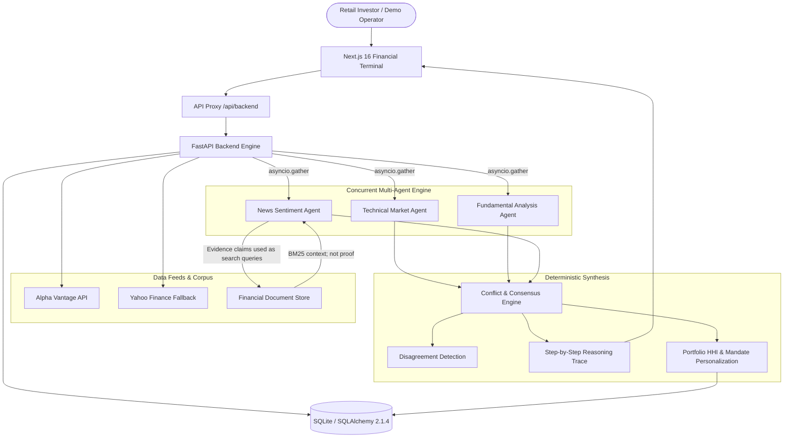

# FinWiseAI — Smarter Insights. Better Investments.

> **Smarter Insights. Better Investments.**  
> Multi-agent financial research terminal featuring deterministic disagreement detection, source-attributed document retrieval, and portfolio concentration context. Seed corpus and benchmark examples are synthetic demonstrations.

---

## 1. Executive Overview

Retail investors frequently suffer losses relying on single-metric models or black-box predictions that obscure underlying analytical contradictions. **FinWiseAI** does not manufacture a single bullish or bearish price target. Instead, it concurrently runs specialized deterministic analysis services, classifies independent market signals, retrieves related financial-document context, surfaces disagreements, and personalizes risk context to an investor's portfolio mandate without altering underlying market observations. The seeded documents are synthetic; BM25 retrieval does not verify claims, and public SEC ingestion is not implemented.

### Core Differentiators
1. **Agent Disagreement Intelligence**: Opposing directional views (e.g. Bullish Technical Momentum vs Bearish Fundamental Valuation) are preserved as primary signals rather than masked behind arbitrary averages.
2. **Financial-Document Retrieval**: Documents are chunked and ranked with BM25. Seeded filing-style passages are synthetic; relevance indicates topical similarity and does not verify or prove an agent claim. Source names and links are displayed when supplied.
3. **Investor Profile Personalization**: Herfindahl-Hirschman Index (HHI) concentration analytics tailor suitability, downside warnings, and diligence questions for different investor mandates (e.g. Conservative Capital Preservation vs Aggressive Growth) while keeping factual market data identical.
4. **Monotonic Latency & 30-Day Forward Return Evaluation**: End-to-end and per-agent monotonic execution latencies are logged alongside a 30-day forward-return benchmark log.

---

## 2. System Architecture



---

## 3. Technology Stack

- **Backend**: Python 3.13, FastAPI, SQLAlchemy 2.1.4, Pydantic v2, httpx, yfinance, Pandas, NumPy, SQLite.
- **Frontend**: Next.js 16.4 (App Router), React 19, TypeScript, Tailwind CSS, Recharts, Lucide Icons.
- **Verification**: Pytest, Node's built-in test runner for the API proxy, ESLint, TypeScript, and the supported webpack production build.

---

## 4. Quick Start & Startup Commands

### Prerequisites
- Python 3.11+ (Windows environment verified on Python 3.13)
- Node.js 20.9+ and npm (required by the pinned Next.js version)

### Backend Setup & Startup
```powershell
# Navigate to backend directory
cd C:\vantageai\backend

# Create the virtual environment once, then install pinned backend dependencies
py -3.13 -m venv .venv
& ".\.venv\Scripts\python.exe" -m pip install -r requirements.txt

# Activate the virtual environment
.\.venv\Scripts\Activate.ps1

# Run database table creation and launch FastAPI server
# Use a dedicated local demo database; startup creates tables and seeds demo data.
$env:DATABASE_URL = "sqlite:///C:/vantageai/backend/vantageai-demo.sqlite3"
python -m uvicorn app.main:app --reload --port 8000
```
- API Documentation (Swagger / OpenAPI): [http://127.0.0.1:8000/docs](http://127.0.0.1:8000/docs)
- Health Check: [http://127.0.0.1:8000/api/v1/health](http://127.0.0.1:8000/api/v1/health)

### Frontend Setup & Startup
```powershell
# Navigate to improved frontend directory
cd C:\vantageai\frontend-improved

# Install dependencies if necessary
npm install

# Launch Next.js development server
npm run dev
```
- Frontend Terminal Interface: [http://localhost:3000](http://localhost:3000)

---

## 5. Automated Testing & Verification

Run the full Python test suite (test count varies as regression coverage changes):
```powershell
cd C:\vantageai\backend
$env:DATABASE_URL = "sqlite:///C:/vantageai/backend/test-vantageai.sqlite3"
& ".\.venv\Scripts\python" -m pytest -v
```

Run the frontend production build (type checking and static route generation):
```powershell
cd C:\vantageai\frontend-improved
npm run build
```

Run focused frontend proxy tests and lint:
```powershell
npm test
npm run lint
npx tsc --noEmit
```

## 6. Production Deployment Boundary

The improved frontend can be deployed independently as a Next.js application. In Vercel, set the project Root Directory to `frontend-improved`, install with `npm ci`, and build with `npm run build`. The frontend's `/api/backend` route proxies requests on the server; configure the server-side `BACKEND_URL` to the publicly reachable HTTPS base URL of the separately hosted FastAPI service. If it is omitted, the proxy falls back to `http://127.0.0.1:8000`, which is only suitable for local development. Do not use a static export.

The backend is a separate ASGI service started from `backend` with `uvicorn app.main:app --host 0.0.0.0 --port <provider-port>`. Set `DATABASE_URL` to a writable, persistent SQLite path on the host. The application currently has no migration framework and runs `create_all` plus demo seeding at startup. Its dependencies do not include a PostgreSQL driver; do not point it at an unsupported database URL. A non-persistent serverless filesystem is not suitable for the SQLite database.

Backend settings read these environment variable names: `DATABASE_URL`, `FRONTEND_ORIGIN`, `ENVIRONMENT`, `APP_NAME`, `APP_VERSION`, `ALPHA_VANTAGE_API_KEY`, and `EVALUATION_UPDATE_TOKEN`. Set `FRONTEND_ORIGIN` to the deployed frontend origin when direct browser-to-backend access is used; the normal frontend proxy itself is server-to-server. `ALPHA_VANTAGE_API_KEY` is optional because a Yahoo Finance fallback exists. `EVALUATION_UPDATE_TOKEN` is needed only to enable the protected manual evaluation-update endpoint. `OPENROUTER_API_KEY` and `OPENROUTER_MODEL` are declared settings but currently unused. The frontend requires `BACKEND_URL`; keep provider credentials on the backend and never use a `NEXT_PUBLIC_` prefix for them.

The current API does not provide general user authentication or per-user data isolation, and several profile, analysis, and demo-seed routes are unauthenticated. Do not expose it as a public multi-user financial product until access control, rate limits, and user-data isolation are addressed. The current database and seeded records are prototype/demo data.

---

## 7. Demonstration Seed Setup

The platform automatically primes its demonstration environment on startup. You can also re-trigger seeding at any time via:
```powershell
Invoke-RestMethod -Method Post -Uri "http://127.0.0.1:8000/api/v1/demo/seed"
```
Seeded assets include:
- **Synthetic Filing-Style Corpus**: Illustrative scenarios for AAPL, MSFT, NVDA, GOOGL, TSLA, plus an explicit synthetic stress test. These are not SEC filings and are labeled synthetic in retrieval results.
- **Investor Profiles**:
  1. *Conservative Capital Preservation* (Risk 1/5, 36 mos, defensive cash & healthcare holdings, HHI 0.29).
  2. *Aggressive Growth Investor* (Risk 5/5, 60 mos, high-beta tech concentration, HHI 0.275).
- **Synthetic Evaluation Examples**: 10 illustrative completed and pending records. They are excluded from real accuracy metrics; actual performance remains unavailable until verified market outcomes are ingested.

---

## 8. Operational Limitations & Disclaimers

1. **Informational & Educational Use Only**: FinWiseAI is designed for retail research and hackathon demonstration. It does not provide personalized investment advice or guaranteed return forecasts.
2. **Delayed Market Feeds**: Daily OHLCV quotes represent completed session closes from public and fallback APIs.
3. **Synthetic Demonstration Data**: Clearly labeled and excluded from real accuracy metrics. Seeded document examples are not filed disclosures.
